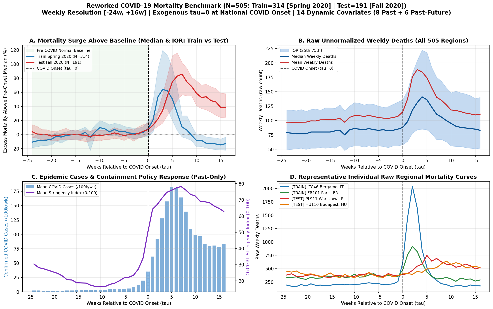

# Reworked COVID-19 Weekly Mortality Benchmark

Multi-regional European all-cause mortality benchmark designed for **surge / disruption time-series forecasting** with an exogenous, justifiable $\tau = 0$ onset alignment, normal pre-onset baseline, sustained multi-week surge, strict chronological & spatial train/test separation, raw physical units, and explicit `past_only` vs. `past_future` vs. `static` covariate roles.



---

## Notebooks & Datasets

| File | Description | Size / Shape |
| :--- | :--- | :--- |
| [`01_covid_mortality_dataset_and_correlation.ipynb`](01_covid_mortality_dataset_and_correlation.ipynb) | Loads full dataset, computes `deaths_vs_4w_avg_diff`, uses the correlation matrix (`\|r\| > 0.90`) to justify pruning 7 redundant covariates, creates the clean CSV, documents `past_only` vs. `past_future` vs. `static` roles, checks train/test split, and plots before/after onset. | 15 cells (executed) |
| [`02_covid_visualize_features_around_onset.ipynb`](02_covid_visualize_features_around_onset.ipynb) | Commented, readable visualization walkthrough built strictly on `covid_mortality_simple.csv` (4-panel overview, 14-feature grid around $\tau = 0$, single-region Warsaw trace, before/after summary table). | 11 cells (executed) |
| `data/covid_mortality_simple.csv` | **Recommended modeling & EDA table:** 505 European NUTS-3 regions $\times$ 41 weeks ($\tau \in [-24, +16]$), zero redundant features ($\max \|r\| = 0.843$), 0 NaNs. | `20,705 rows x 27 cols` (`3.51 MB`) |
| `data/reworked_covid_mortality_weekly.npz` / `.pt` | Pre-split multivariate tensors containing all 20 full candidate dynamic channels (`past_covariates`, `past_future_covariates`), `static_features`, `tau_steps`, `train_mask`, and `test_mask`. | `(505, 41, F)` |
| `data/reworked_covid_mortality_metadata.csv` | One row per region window with NUTS-3 ID, country, `onset_week`, chronological bounds, baseline median deaths, and peak ratios. | `505 rows x 20 cols` |

---

## Data Sources (Public Archives)

1. **Eurostat (`demo_r_mwk3_ts`)** — Weekly all-cause deaths (Total, Male, Female) across European NUTS-3 regions.
2. **Eurostat GISCO (`NUTS 2021`)** — NUTS-3 region centroid coordinates (`latitude`, `longitude`) and official `urban_type`, `coast_type`, `mount_type` codes.
3. **Oxford COVID-19 Government Response Tracker (`OxCGRT`)** — Daily national confirmed COVID-19 cases, confirmed COVID-19 deaths, and government containment/economic policy indices aggregated by ISO week.
4. **Our World in Data (`OWID`)** — National population counts used to normalize confirmed cases and deaths per 100,000 inhabitants.
5. **NASA POWER (`MERRA-2` Reanalysis)** — Regional daily 2m air temperature, relative humidity, surface pressure, 10m wind speed, and precipitation aggregated by ISO week.

---

## Feature Roles (Simple Clean CSV: 14 Dynamic + 5 Static + 8 Metadata)

Correlation pruning on the full 21 candidate dynamic features removed **7 redundant features** where $|r| > 0.90$ against a primary variable: `deaths_male` ($r = +0.994$), `deaths_female` ($r = +0.994$), `deaths_rolling_mean_4w` ($r = +0.943$), `containment_index` ($r = +0.982$), `gov_response_index` ($r = +0.977$), `temp_max_c` ($r = +0.985$), and `month` ($r = +0.921$).

### Dynamic `past_only` Covariates (8 channels — observed up to forecast origin)
| Column | Meaning & Unit |
| :--- | :--- |
| `deaths_total` | **[TARGET]** Weekly all-cause regional deaths (raw count/week) |
| `deaths_change_1w` | 1-week backward mortality change (`deaths[t] - deaths[t-1]`, count/week) |
| `deaths_vs_4w_avg_diff` | Excess weekly deaths vs. trailing 4-week rolling mean (`count/week`) |
| `male_death_share` | Male fraction of weekly deaths (`deaths_male / deaths_total`, `0–1`) |
| `covid_cases_100k` | National weekly confirmed COVID-19 cases per 100k population |
| `covid_deaths_100k` | National weekly confirmed COVID-19 deaths per 100k population |
| `stringency_index` | OxCGRT Stringency Index (`0–100`) |
| `economic_support_index` | OxCGRT Economic Support Index (`0–100`) |

### Dynamic `past_future` Covariates (6 channels — exogenous meteorology & calendar)
| Column | Meaning & Unit |
| :--- | :--- |
| `temp_c` | Weekly mean 2m air temperature (°C) |
| `humidity_pct` | Weekly mean 2m relative humidity (%) |
| `pressure_hpa` | Weekly mean surface pressure (hPa) |
| `wind_ms` | Weekly mean 10m wind speed (m/s) |
| `rain_mm_week` | Weekly total precipitation (mm/week) |
| `week_of_year` | ISO calendar week of year (`1–53`) |

### Static & Metadata Columns
- **Static (`5`):** `latitude`, `longitude`, `urban_type` (`1`=Urban, `2`=Intermediate, `3`=Rural), `coast_type` (`1`=Coastal, `2`=Semi-coastal, `3`=Inland), `mount_type` (`1..3`=Mountainous, `4`=Non-mountainous).
- **Metadata (`8`):** `sample_id`, `region_id`, `region_name`, `country_code`, `split`, `onset_week`, `iso_week`, `tau_week` (`-24` to `+16`).

---

## Chronological & Disjoint Split Summary

| Split | Regions ($N$) | Countries | Window Range | Onset Range ($\tau = 0$) | Median Baseline Deaths/wk | Median Peak Deaths/wk | Median Peak Ratio |
| :--- | :---: | :---: | :--- | :--- | :---: | :---: | :---: |
| **Train** (Spring 2020) | `314` | `9` (`UK, IT, FR, ES, NL, BE, SE, CH, PT`) | `2019-W38` .. `2020-W29` | `2020-W10` .. `2020-W13` | `75.75` | `162.0` | `1.905x` |
| **Test** (Fall 2020) | `191` | `12` (`PL, AT, HU, RS, EL, CZ, SK, LT, LV, DK, EE, CY`) | `2020-W14` .. `2021-W10` | `2020-W38` .. `2020-W47` | `85.00` | `176.0` | `2.123x` |

- **Zero entity overlap** and a **$\ge 9$-week chronological separation** (`max train week 2020-W29 < min test onset 2020-W38`).

---

## Quickstart

```python
import pandas as pd

df = pd.read_csv("data/covid_mortality_simple.csv")
train_df = df[df["split"] == "train"]
test_df = df[df["split"] == "test"]
```
