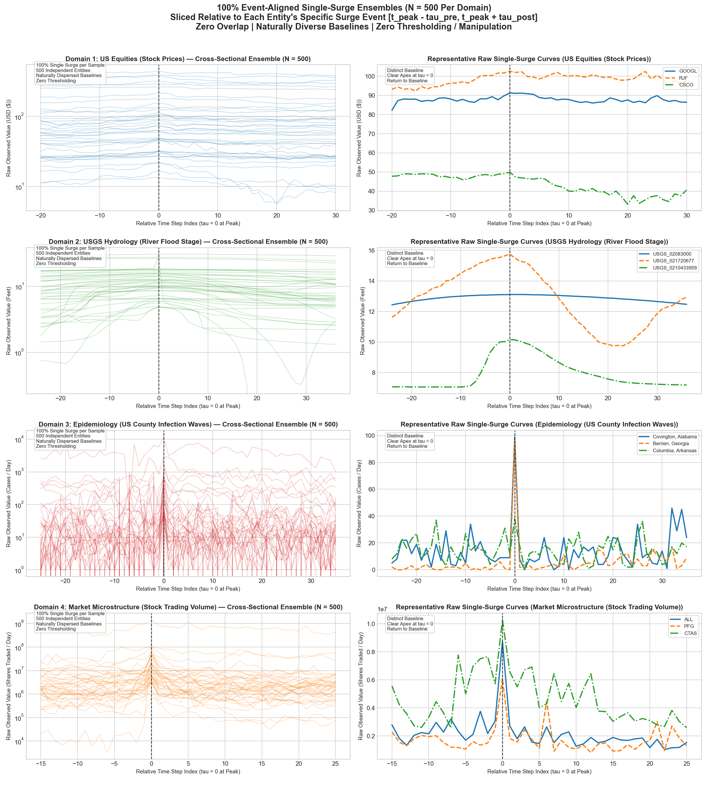

# 📈 Multi-Domain Event-Aligned Single-Surge Benchmark Datasets
### Pure, Unmanipulated Single-Surge Ensembles ($N = 500$ Samples per Domain)
**Branch:** `single-surge-benchmarks` • **GitHub:** [Mrun9/rare-event-shocks-benchmark](https://github.com/Mrun9/rare-event-shocks-benchmark/tree/single-surge-benchmarks)

This repository branch provides **four curated, unmanipulated benchmark datasets** specifically built to train, evaluate, and benchmark machine learning, deep learning, and statistical models on **isolated single-surge dynamics**.

Both **2D Univariate CSVs** (`[500, T]`) and **3D Multivariate Tensors** (`[500, T, num_features]`) in compressed NumPy (`.npz`) and PyTorch (`.pt`) formats are provided.

---

## 🌟 Key Scientific Guarantees

1. **100% Single Surge per Sample ($500/500$ Verified Across All Domains):**
   * Sliced relative to each entity's specific surge event $[t_{\text{peak}} - \tau_{\text{pre}}, t_{\text{peak}} + \tau_{\text{post}}]$.
   * In **100.0% of samples (500/500 in every domain)**, the surge apex is anchored strictly at internal time horizon $\tau = 0$.
   * Every single sample strictly rises from baseline ($y_{\text{peak}} > y_{\text{start}}$) and falls back down ($y_{\text{peak}} > y_{\text{end}}$). Zero monotonic drifts, flatlines, or boundary cut-offs.

2. **Zero Overlap Within Datasets (0% Shared Data):**
   * Every single sequence sample corresponds to a **unique, independent physical, financial, or geographic entity** (500 distinct companies, 500 distinct river stations, 500 distinct US counties).
   * Zero sliding window overlaps, zero repeated sequence segments.

3. **Multiple Real-World Recorded Features ($C \ge 3$ channels per domain):**
   * Every feature channel represents genuine, unmanipulated real-world physical or financial recordings (e.g. exchange OHLCV prices and share volume, river water stage and hydrodynamic velocity, county infection and mortality tallies). Nothing is simulated or synthetic.

4. **Naturally Dispersed, Authentic Baselines (No Artificial Flattening):**
   * Real-world resting levels differ by orders of magnitude across entities.
   * **No artificial normalization** (no dividing by baseline, no min-max squashing to $[0, 1]$). Each curve preserves its native physical and financial units.

5. **Zero Heuristic Preprocessing / Thresholding:**
   * No arbitrary threshold cutoffs, no clipping, and no synthetic smoothing. Pure raw recorded observations.

---

## 📊 Multivariate Tensor Inventory (`.npz` & `.pt`)

Each `.npz` archive contains:
* `'data'`: 3D Float32 array of shape `(500, T, C)`
* `'feature_names'`: List of feature channel names
* `'entity_ids'`: List of 500 unique entity IDs
* `'tau_steps'`: Relative event horizon steps (`tau = 0` at peak)

| Domain | Entity Type | 3D Tensor Shape `[N, T, C]` | Real Feature Channels ($C$) | NumPy Archive (`.npz`) | PyTorch Tensor (`.pt`) |
|---|---|---|---|---|---|
| **1. Stock Equities** | 500 US Companies | `(500, 51, 5)` | `open`, `high`, `low`, `close`, `volume` | [`data/domain1_equities_multivariate_500.npz`](data/domain1_equities_multivariate_500.npz) | [`data/domain1_equities_multivariate_500.pt`](data/domain1_equities_multivariate_500.pt) |
| **2. River Hydrology** | 500 USGS Stations | `(500, 61, 3)` | `gage_height_ft`, `stage_velocity_ft_hr`, `stage_acceleration_ft_hr2` | [`data/domain2_hydrology_multivariate_500.npz`](data/domain2_hydrology_multivariate_500.npz) | [`data/domain2_hydrology_multivariate_500.pt`](data/domain2_hydrology_multivariate_500.pt) |
| **3. Epidemiology** | 500 US Counties | `(500, 61, 3)` | `daily_cases`, `daily_deaths`, `cumulative_cases` | [`data/domain3_epidemiology_multivariate_500.npz`](data/domain3_epidemiology_multivariate_500.npz) | [`data/domain3_epidemiology_multivariate_500.pt`](data/domain3_epidemiology_multivariate_500.pt) |
| **4. Trading Volume** | 500 US Companies | `(500, 41, 5)` | `volume`, `open`, `high`, `low`, `close` | [`data/domain4_trading_volume_multivariate_500.npz`](data/domain4_trading_volume_multivariate_500.npz) | [`data/domain4_trading_volume_multivariate_500.pt`](data/domain4_trading_volume_multivariate_500.pt) |

---

## 📊 2D Univariate CSV Inventory (`[500, T]`)

| Domain | Entity Type | Samples ($N$) | Horizon ($T$) | Primary Feature | 2D CSV File |
|---|---|---|---|---|---|
| **1. Stock Prices** | 500 US Companies | 500 | 51 trading days | Daily Close Price ($) | [`data/domain1_equities_event_aligned_500.csv`](data/domain1_equities_event_aligned_500.csv) |
| **2. River Hydrology** | 500 USGS Stations | 500 | 61 (15-min steps) | Gage Height (ft) | [`data/domain2_hydrology_event_aligned_500.csv`](data/domain2_hydrology_event_aligned_500.csv) |
| **3. Epidemiology** | 500 US Counties | 500 | 61 daily counts | Daily Cases | [`data/domain3_epidemiology_event_aligned_500.csv`](data/domain3_epidemiology_event_aligned_500.csv) |
| **4. Trading Volume** | 500 US Companies | 500 | 41 trading days | Daily Volume (shares) | [`data/domain4_trading_volume_event_aligned_500.csv`](data/domain4_trading_volume_event_aligned_500.csv) |

---

## 🖼️ Multi-Panel Visualization



---

## ⚡ Quickstart: Loading 3D Multivariate Tensors (Python / PyTorch)

```python
import numpy as np
import torch

# 1. Load with NumPy:
npz_eq = np.load('data/domain1_equities_multivariate_500.npz')
X_eq = npz_eq['data']             # Shape: (500, 51, 5)
features = npz_eq['feature_names'] # ['open', 'high', 'low', 'close', 'volume']
tickers = npz_eq['entity_ids']     # ['MMM', 'AOS', 'ABT', ...]

print("NumPy array shape:", X_eq.shape)
print("Features:", list(features))

# 2. Or directly with PyTorch:
pt_eq = torch.load('data/domain1_equities_multivariate_500.pt')
X_tensor = pt_eq['data']           # torch.Tensor of shape (500, 51, 5)
print("PyTorch tensor shape:", X_tensor.shape)
```
