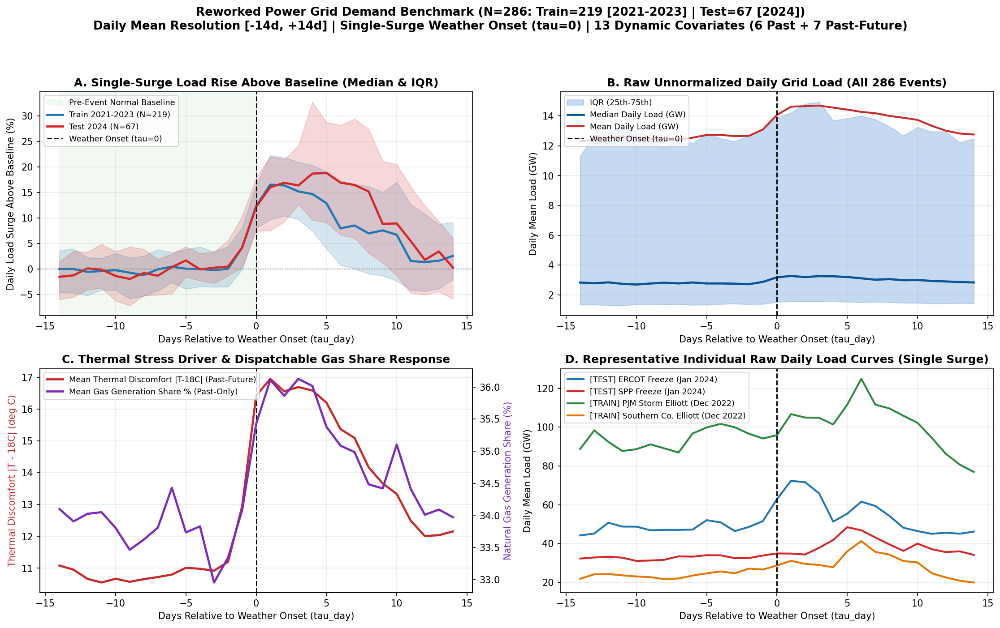

# ⚡ Reworked Power Grid Demand Surge Benchmark (Daily, Weather-Onset Aligned)

Multi-region U.S. electricity demand benchmark built for **surge / disruption time-series forecasting** around extreme thermal weather onsets ($\tau = 0$: heatwaves and Arctic freezes). Using **daily mean resolution (`[-14d, +14d]`)** eliminates the 24-hour diurnal cycle so each event forms **one clean single surge** above a flat 2-week pre-onset baseline, with strict chronological separation (`2021–2023` Train vs. `2024` Test), raw physical MW units, and explicit `past_only` vs. `past_future` vs. `static` covariate roles.



---

## Notebooks & Datasets

| File | Description | Size / Shape |
| :--- | :--- | :--- |
| [`01_power_grid_dataset_and_correlation.ipynb`](01_power_grid_dataset_and_correlation.ipynb) | Loads full dataset, engineers `thermal_discomfort_c = \|temp_c - 18.0\|`, uses the 19-feature correlation matrix (`\|r\| > 0.90`) to justify pruning 6 redundant features, saves `power_grid_simple.csv`, documents covariate roles, checks chronological split, and plots before/after load surge. | 15 cells (executed) |
| [`02_power_grid_visualize_features_around_onset.ipynb`](02_power_grid_visualize_features_around_onset.ipynb) | Commented, readable visualization walkthrough built strictly on `power_grid_simple.csv` (4-panel single-surge overview, 13-feature grid around $\tau = 0$, heatwave vs. freeze split, ERCOT Jan 2024 freeze trace, before/after summary table). | 11 cells (executed) |
| `data/power_grid_simple.csv` | **Recommended modeling & EDA table:** `286` extreme weather events across `48+` US Balancing Authorities $\times$ `29` days ($\tau_{\text{day}} \in [-14, +14]$), zero redundant features ($\max \|r\| = 0.780$, max $\text{VIF} = 5.06$), 0 NaNs. | `8,294 rows x 24 cols` (`1.53 MB`) |
| `data/reworked_power_grid_daily.npz` / `.pt` | Pre-split multivariate tensors containing all 18 full candidate dynamic channels (`past_covariates`, `past_future_covariates`), `static_features`, `tau_steps`, `train_mask`, and `test_mask`. | `(286, 29, F)` |
| `data/reworked_power_grid_metadata.csv` | One row per event window with Balancing Authority, region, `event_type` (`heatwave`/`freeze`), `onset_date`, baseline MW, peak MW, and peak surge ratio. | `286 rows x 15 cols` |

---

## Data Sources (Public Archives)

1. **U.S. EIA-930 Electric Grid Monitor (`EIA930_BALANCE` 2021–2024)** — Hourly demand, forecast, net generation, interchange, and fuel-source generation aggregated cleanly to daily local-date averages.
2. **NASA POWER (`MERRA-2` Reanalysis)** — Daily mean 2m air temperature, relative humidity, downward shortwave solar irradiance, 10m wind speed, and surface pressure at each Balancing Authority's centroid.
3. **Electricity Maps / EIA Capacity Metadata** — Balancing Authority centroids (`latitude`, `longitude`) and installed nameplate generation capacity (`installed_cap_mw`).

---

## Feature Roles (Simple Clean CSV: 13 Dynamic + 3 Static + 8 Metadata)

Correlation pruning on the 19 candidate dynamic features removed **6 redundant scale/temperature duplicates** where $|r| > 0.90$: `demand_forecast_mw` ($r = +0.999$), `net_gen_mw` ($r = +0.997$), `load_rolling_mean_7d` ($r = +0.996$), `gas_gen_mw` ($r = +0.969$), `coal_gen_mw` ($r = +0.910$), and `apparent_temp_c` ($r = +0.991$ vs. `temp_c`). Scale-invariant fuel shares (`gas_share`, `solar_share`, `wind_share`, `import_share`) replace raw MW counts cleanly ($\max |r| = 0.780$, $\max \text{VIF} = 5.06$).

### Dynamic `past_only` Covariates (6 channels — observed up to $\tau_{\text{day}} = 0$)
| Column | Meaning & Unit |
| :--- | :--- |
| `load_mw` | **[TARGET]** Daily mean system electricity demand (`Demand (MW)`, EIA-930) |
| `load_change_1d` | 1-day backward load change (`load[d] - load[d-1]`, MW/day) |
| `gas_share` | Natural gas fraction of net generation (`0–1`) |
| `solar_share` | Utility solar PV fraction of net generation (`0–1`) |
| `wind_share` | Wind fraction of net generation (`0–1`) |
| `import_share` | Net electricity import ratio (`-interchange / load`) |

### Dynamic `past_future` Covariates (7 channels — weather forecasts & calendar)
| Column | Meaning & Unit |
| :--- | :--- |
| `temp_c` | Daily mean 2m air temperature (°C, NASA POWER MERRA-2) |
| `thermal_discomfort_c` | Absolute departure from 18 °C comfort baseline (`\|temp_c - 18.0\|` °C) |
| `humidity_pct` | Daily mean 2m relative humidity (%) |
| `solar_wm2` | Daily mean shortwave solar irradiance (W/m²) |
| `wind_ms` | Daily mean 10m wind speed (m/s) |
| `pressure_hpa` | Daily mean surface barometric pressure (hPa) |
| `day_of_week` | Day of week (`0=Mon .. 6=Sun`) |

### Static & Metadata Columns
- **Static (`3`):** `latitude`, `longitude`, `installed_cap_mw`.
- **Metadata (`8`):** `sample_id`, `ba`, `region`, `split`, `event_type`, `onset_date`, `date`, `tau_day` (`-14` to `+14`).

---

## Chronological Split Summary

| Split | Events ($N$) | Unique BAs | Heatwaves | Freezes | Earliest Window | Latest Window | Median Baseline (MW) | Median Peak (MW) | Median Peak Ratio |
| :--- | :---: | :---: | :---: | :---: | :--- | :--- | :---: | :---: | :---: |
| **Train** (`2021–2023`) | `219` | `48` | `80` | `139` | `2021-01-10` | `2023-12-12` | `2,660.8` | `3,435.0` | `1.245x` |
| **Test** (`2024`) | `67` | `39` | `31` | `36` | `2023-12-19` | `2024-12-24` | `3,238.6` | `4,642.0` | `1.300x` |

- Zero window overlap (minimum `25-day` spacing within any BA) and strict chronological separation (`max train date 2023-12-12 < min test date 2023-12-19`).

---

## Quickstart

```python
import pandas as pd

df = pd.read_csv("data/power_grid_simple.csv")
train_df = df[df["split"] == "train"]
test_df = df[df["split"] == "test"]
```
