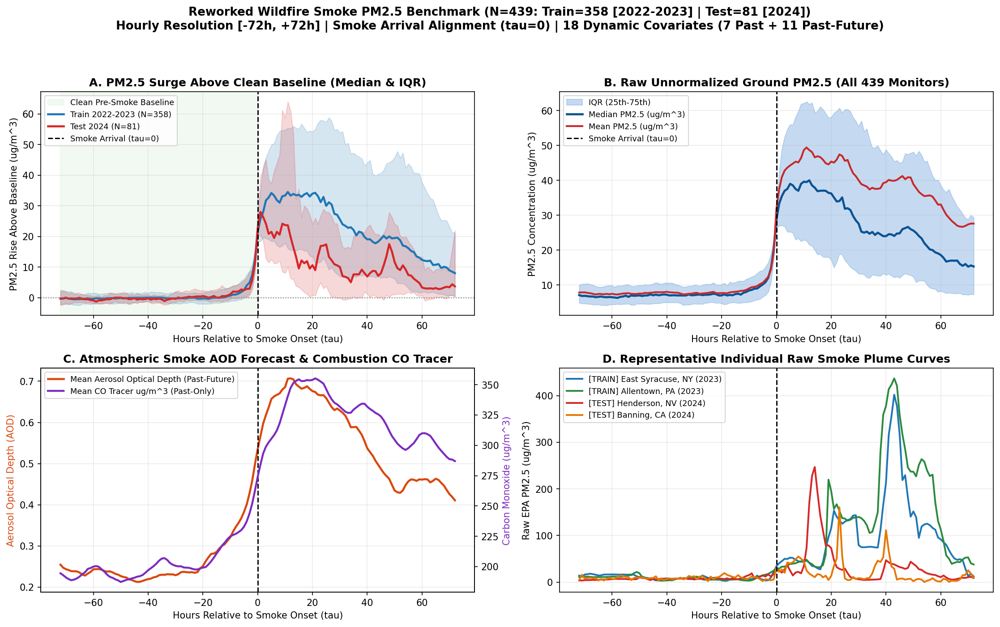

# 🌫️ Reworked Urban Wildfire Smoke `PM2.5` Benchmark (Hourly, Plume-Onset Aligned)

Multi-station U.S. wildfire smoke air-quality benchmark built for **surge / disruption time-series forecasting** around wildfire plume arrival ($\tau = 0$), with clean 72-hour pre-smoke baselines, sustained multi-day plumes (excluding Independence Day fireworks spikes), **100% unique physical EPA stations**, strict chronological separation (`2022–2023` Train vs. `2024` Test), raw physical concentrations ($\mu\text{g/m}^3$), and explicit `past_only` vs. `past_future` vs. `static` dispersion roles.



---

## Notebooks & Datasets

| File | Description | Size / Shape |
| :--- | :--- | :--- |
| [`01_wildfire_smoke_dataset_and_correlation.ipynb`](01_wildfire_smoke_dataset_and_correlation.ipynb) | Loads full dataset, engineers `smoke_trapping_index = aerosol_optical_depth / (PBLH_km + 0.1)`, uses the 20-feature correlation matrix (`\|r\| > 0.90`) to justify pruning 2 redundant variables, saves `wildfire_smoke_simple.csv`, documents covariate roles, checks `0%` station overlap, and plots East Syracuse (`NY`) + all `439` stations. | 15 cells (executed) |
| [`02_wildfire_smoke_visualize_features_around_onset.ipynb`](02_wildfire_smoke_visualize_features_around_onset.ipynb) | Commented, readable visualization walkthrough built strictly on `wildfire_smoke_simple.csv` (4-panel overview, 18-feature + 2-static grid around $\tau = 0$, Banning `CA` 2024 trace, before/after summary table). | 11 cells (executed) |
| `data/wildfire_smoke_simple.csv` | **Recommended modeling & EDA table:** `439` unique US EPA monitors $\times$ `145` hours ($\tau \in [-72, +72]$), zero redundant features ($\max \|r\| = 0.760$, max $\text{VIF} = 4.15$), 0 NaNs. | `63,655 rows x 30 cols` (`13.21 MB`) |
| `data/reworked_wildfire_smoke_hourly.npz` / `.pt` | Pre-split multivariate tensors containing all 19 full candidate dynamic channels (`past_covariates`, `past_future_covariates`), `static_features`, `tau_steps`, `train_mask`, and `test_mask`. | `(439, 145, F)` |
| `data/reworked_wildfire_smoke_metadata.csv` | One row per station plume event with EPA `site_id`, city, state, `onset_utc`, pre-smoke median, post-onset peak `PM2.5`, peak `AOD`, elevation, and urban/rural setting. | `439 rows x 16 cols` |

---

## Data Sources (Public Archives)

1. **U.S. EPA Air Quality System (`AQS hourly_88101` 2022–2024 & `aqs_sites`)** — Hourly ground-truth `PM2.5` monitor readings ($\mu\text{g/m}^3$) and station elevation / land-setting codes.
2. **Open-Meteo ERA5 Reanalysis Archive** — Hourly planetary boundary layer height (`boundary_layer_height_m`), 10m wind speed & direction vectors (`wind_ms`, `wind_dir_sin`, `wind_dir_cos`), precipitation (`rain_mm_hr`), 2m temperature, humidity, and surface pressure.
3. **Open-Meteo CAMS Air Quality Archive** — Hourly columnar smoke aerosol optical depth (`aerosol_optical_depth`) and co-pollutant tracers (`pm10_cams_ug_m3`, `co_ug_m3`, `ozone_ug_m3`, `no2_ug_m3`, `dust_ug_m3`).

---

## Feature Roles (Simple Clean CSV: 18 Dynamic + 4 Static + 8 Metadata)

Correlation pruning across the 20 candidate dynamic features removed **2 redundant features** with $|r| > 0.90$: `pm25_rolling_mean_6h` ($r = +0.921$ vs. `pm25_ug_m3`) and `apparent_temp_c` ($r = +0.947$ vs. `temp_c`). All 18 kept dynamic features maintain $\max |r| = 0.760$ and $\max \text{VIF} = 4.15$.

### Dynamic `past_only` Covariates (7 channels — observed up to $\tau = 0$)
| Column | Meaning & Unit |
| :--- | :--- |
| `pm25_ug_m3` | **[TARGET]** Hourly EPA ground `PM2.5` ($\mu\text{g/m}^3$) |
| `pm25_change_1h` | 1-hour concentration rate of change ($\mu\text{g/m}^3/\text{hr}$) |
| `pm10_cams_ug_m3` | Coarse particulate matter `PM10` ($\mu\text{g/m}^3$, CAMS) |
| `co_ug_m3` | Carbon monoxide biomass combustion tracer ($\mu\text{g/m}^3$, CAMS) |
| `ozone_ug_m3` | Ground-level ozone `O3` ($\mu\text{g/m}^3$, CAMS) |
| `no2_ug_m3` | Nitrogen dioxide urban baseline combustion tracer ($\mu\text{g/m}^3$, CAMS) |
| `dust_ug_m3` | Mineral dust separation tracer ($\mu\text{g/m}^3$, CAMS) |

### Dynamic `past_future` Covariates (11 channels — dispersion & smoke transport forecasts)
| Column | Meaning & Unit |
| :--- | :--- |
| `aerosol_optical_depth` | Columnar overhead smoke Aerosol Optical Depth forecast (`AOD`, CAMS) |
| `boundary_layer_height_m` | Planetary Boundary Layer Height (`m`, ERA5) — vertical mixing / trapping |
| `smoke_trapping_index` | Engineered trapping proxy `aerosol_optical_depth / (PBLH_km + 0.1)` |
| `wind_ms` | 10m wind speed (m/s, ERA5) |
| `wind_dir_sin` | Sine of 10m wind direction (continuous E–W transport vector) |
| `wind_dir_cos` | Cosine of 10m wind direction (continuous N–S transport vector) |
| `temp_c` | 2m air temperature (°C, ERA5) |
| `humidity_pct` | 2m relative humidity (%, ERA5) |
| `pressure_hpa` | Surface barometric pressure (hPa, ERA5) |
| `rain_mm_hr` | Hourly precipitation scavenging wash-out (mm/hr, ERA5) |
| `local_hour` | Local hour of day (`0–23`, diurnal boundary-layer inversion cycle) |

### Static & Metadata Columns
- **Static (`4`):** `latitude`, `longitude`, `elevation_m`, `setting_code` (`1`=Urban Center, `2`=Suburban, `3`=Rural).
- **Metadata (`8`):** `sample_id`, `site_id`, `city`, `state`, `split`, `onset_utc`, `timestamp_utc`, `tau_hour` (`-72` to `+72`).

---

## Chronological & Zero-Overlap Split Summary

| Split | Unique EPA Stations ($N$) | States | Earliest Window | Latest Window | Median Baseline (`ug/m^3`) | Median Peak (`ug/m^3`) | Median Peak Hour ($\tau$) |
| :--- | :---: | :---: | :--- | :--- | :---: | :---: | :---: |
| **Train** (`2022–2023`) | `358` | `44` | `2022-08-10 05:00` | `2023-10-27 23:00` | `7.23` | `89.15` | `+24.0h` |
| **Test** (`2024`) | `81` | `20` | `2024-06-23 01:00` | `2024-10-28 07:00` | `7.10` | `104.55` | `+23.0h` |

- **Zero shared sensors:** `0` station IDs shared between `train` and `test` (`439/439` distinct monitors).
- **Strict chronological gap:** `> 7` months (`max train end 2023-10-27 23:00 < min test start 2024-06-23 01:00`).

---

## Quickstart

```python
import pandas as pd

df = pd.read_csv("data/wildfire_smoke_simple.csv")
train_df = df[df["split"] == "train"]
test_df = df[df["split"] == "test"]
```
