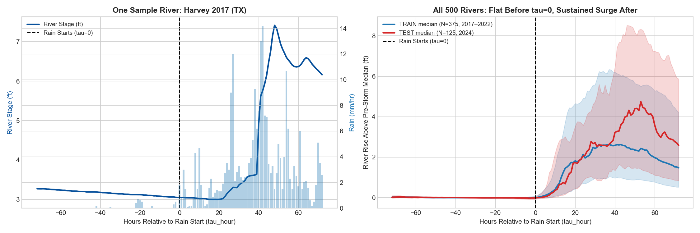

# 🌊 Reworked Hydrology Benchmark (Hourly, Storm-Onset Aligned)

**Branch:** `reworked-hydrology-onset` • **GitHub:** [Mrun9/rare-event-shocks-benchmark](https://github.com/Mrun9/rare-event-shocks-benchmark/tree/reworked-hydrology-onset)

This branch provides the reworked **Multi-Storm Hourly River Flood Dataset** (`N = 500` unique USGS gauges across 17 US states), redesigned around **incident-onset alignment ($\tau = 0$)**, a **3-day calm pre-storm baseline**, **hourly resolution (`[-72h, +72h]`)**, **explicit `past` vs. `past_future` covariates**, **correlation-pruned non-redundant features**, and a **strict chronological `train`/`test` split**.

---

## 📓 Walkthrough Notebook & Datasets

* **Interactive Notebook (Recommended starting point):** [`18_explore_reworked_hydrology_benchmark.ipynb`](18_explore_reworked_hydrology_benchmark.ipynb)
  * Loads the full tensor bundle, tests derived features and inspects the correlation matrix to justify dropping redundant variables (`r > 0.90`), generates the clean non-redundant CSV, lists all `past` vs. `past_future` roles, verifies the chronological `train`/`test` split, and visualizes single-river and cross-sectional trajectories.
* **Clean Non-Redundant CSV (Ready to use):** [`data/reworked_hydrology_simple.csv`](data/reworked_hydrology_simple.csv) (`72,500` rows = `500` rivers × `145` hours; `19` columns; `0` missing values; max off-diagonal `|r| = 0.766`).
* **Full Raw Bundle (All 17 dynamic + 4 static features):**
  * [`data/reworked_domain2_hydrology_storm_onset_hourly.npz`](data/reworked_domain2_hydrology_storm_onset_hourly.npz)
  * [`data/reworked_domain2_hydrology_storm_onset_hourly.pt`](data/reworked_domain2_hydrology_storm_onset_hourly.pt)
  * [`data/reworked_domain2_hydrology_metadata.csv`](data/reworked_domain2_hydrology_metadata.csv)

---

## 🌐 Data Sources (100% Real-World, Zero Normalization/Smoothing)

1. **USGS National Water Information System (NWIS):**
   * Instantaneous Values API (`https://waterservices.usgs.gov/nwis/iv/`): 15-minute river stage height (`00065`) and discharge (`00060`), converted to UTC and averaged to 1-hour steps.
   * Site Service (`https://waterservices.usgs.gov/nwis/site/`): Station coordinates, elevation (`altitude_ft`), and watershed drainage area (`drainage_area_sqmi`).
2. **Open-Meteo ERA5 Historical Weather Archive:**
   * Archive API (`https://archive-api.open-meteo.com/v1/archive`): Hourly precipitation, barometric surface pressure, 10m wind speed, 2m temperature, relative humidity, and top-layer soil moisture at each gauge's location.

---

## 📊 Clean Feature Partition (`data/reworked_hydrology_simple.csv`)

| Role | Availability at Prediction Time ($\tau = 0$) | Columns |
|---|---|---|
| **IDs / Split / Time** | Metadata | `sample_id`, `split`, `storm`, `state`, `timestamp_utc`, `tau_hour` |
| **Target + Past-Only (`2`)** | Observed for `tau_hour <= 0`; masked for `tau_hour > 0` | `stage_ft` *(target)*, `stage_change_1h` |
| **Past-Future (`9`)** | Known across all `tau_hour` (`-72` to `+72`) via weather forecasts & calendar | `rain_mm_hr`, `rain_24h_sum`, `pressure_hpa`, `wind_ms`, `temp_c`, `humidity_pct`, `soil_moisture`, `hour_of_day`, `day_of_week` |
| **Static (`2`)** | Constant per gauge | `drainage_area_sqmi`, `altitude_ft` |

*Removed redundant/noisy columns after correlation audit:* `discharge_cfs` (`r = +0.982` with `stage_ft`), `discharge_velocity_cfs_hr` (`r = +0.956` with `stage_velocity_ft_hr`), `stage_acceleration_ft_hr2`, `stage_rolling_std_6h_ft`, `precip_rolling_6h_mm`, and `hour_sin`/`hour_cos` (replaced by `hour_of_day`).

---

## ⏱️ Chronological Split & Zero Overlap

* **`train` (`N = 375` gauges, `54,375` rows):** 8 historical storm floods from **Aug 2017 – Oct 2022** (`Harvey_2017`, `Irma_2017`, `Florence_2018`, `Michael_2018`, `Midwest_2019`, `Imelda_2019`, `Ida_2021`, `Ian_2022`).
* **`test` (`N = 125` gauges, `18,125` rows):** 5 storm floods from **June 2024 – Oct 2024** (`Midwest_Flood_2024`, `Beryl_2024`, `Debby_2024`, `Helene_2024`, `Milton_2024`).
* **Zero Overlap:** `500/500` unique USGS gauge IDs (`0%` shared stations) and a >20-month strict temporal gap between train and test.

---

## 🖼️ Before & After Storm Onset ($\tau = 0$)



---

## ⚡ Quickstart

```python
import pandas as pd

df = pd.read_csv('data/reworked_hydrology_simple.csv')
train_df = df[df['split'] == 'train']
test_df  = df[df['split'] == 'test']

print("Train rivers:", train_df['sample_id'].nunique())  # 375
print("Test rivers :", test_df['sample_id'].nunique())   # 125
```
